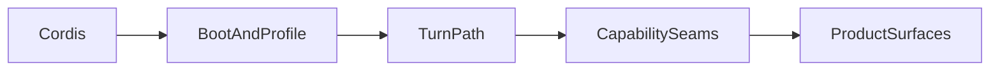

# Source learning path

English | [中文](index.zh.md)

A sequenced path through DeepSeek Harness source: Cordis, profile composition, one complete turn, capability seams, then optional product surfaces. The outcome is being able to follow one turn in code and name the extension point for new behavior.

You need TypeScript and Node familiarity. Cordis is taught in phase 1. Prefer Chinese `*.zh.md` siblings when reading linked docs; package JSDoc stays English.

## How to use this path

1. Complete phases in order. After phase 3 you may jump to phase 6 if you only need plugin authoring, then return to phases 4–5 when you change the loop or a seam.
2. For each phase: read the listed docs, open the listed source files, produce the named deliverable, then check the pass criteria.
3. Worked answers on later pages are reference solutions for those deliverables — write your own first when learning.

## Chapters

0. [Repository map](00-repository-map.md) — layout, glossary, launch rule.
1. [Cordis runtime](01-cordis.md) — primer plus the seven-chapter tutorial.
2. [Profiles and bundles](02-profiles-and-bundles.md) — composition layers and `dump-config`.
3. [First Harness plugin](03-first-plugin.md) — `greet` tool against real `ctx.tools`.
4. [One turn end to end](04-one-turn.md) — session → prompt → tools → llm → agent-loop.
5. [Capability seams](05-capability-seams.md) — Shell triad, approval, persistence.
6. [Extension habits](06-extension-habits.md) — cookbooks, tests, defensive patterns.
7. [Product surfaces](07-product-surfaces.md) — Web, Host, Desktop, SDK (optional).

## Daily reading habits

1. Read the package README and [architecture](../architecture.md) before `src/`.
2. Follow one call chain at a time; use Find references on `ctx.<key>`.
3. Resolve implementation packages from row `id` values in [`packages/bundle/base/cordis.patch.yml`](../../packages/bundle/base/cordis.patch.yml).
4. Before changing lifecycle or session code, open the matching [defensive patterns](../defensive-patterns/README.md) page.
5. Before adding model-visible input, design a session event. **Model-visible means logged.**
6. For “why”, search [`.agents/notes/implemented/`](../../.agents/notes/implemented/) — archived notes are not current authority.

## Progress checklist

| Phase | Deliverable | Pass when |
|---|---|---|
| 0 | Package-group sketch | You can name what `core/`, `bundle/`, `boot/`, and `llm/` own, and that apps launch only through `dsh --profile …` |
| 1 | Runnable Cordis tutorial | You can write a small plugin with `Config`, a service, and an event listener |
| 2 | Annotated `dump-config` | You can draw `web` / `headless` / `sdk-minimal` composition |
| 3 | Local `greet` via `--patch` | You know how the tool schema joins system-prompt assembly |
| 4 | Turn sequence diagram | You separate durable session events from live `agent/*` / `tools/*` / `llm/*` points |
| 5 | Shell triad notes | Given “add X”, you name `ctx.?`, whether a session event is required, and whether a bundle patch row is enough |
| 6 | One small real extension | You know which tests and cookbooks apply |
| 7 | Optional surface map | You open the right package group for UI / Host / Desktop / SDK work |

