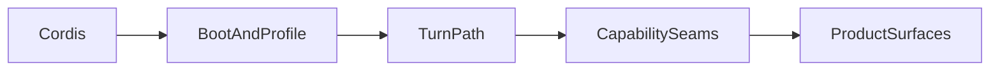

# 源码学习路径

[English](index.md) | 中文

按顺序阅读 DeepSeek Harness 源码：先 Cordis，再 profile 组合，再完整一轮 turn，再到能力 seam，最后按需进入产品面。目标是能在代码里跟完一次 turn，并说出新行为该挂在哪个扩展点。

需要熟悉 TypeScript 与 Node。Cordis 在阶段 1 补齐。链接文档优先读中文 `*.zh.md`；包内 JSDoc 保持英文。

## 怎么用这条路径

1. 按阶段顺序完成。若只写插件，阶段 3 之后可先跳到阶段 6，改循环或 seam 时再补阶段 4–5。
2. 每一阶段：读所列文档、打开所列源码、做出交付物，再对照过关标准。
3. 后续页面中的参考答案是交付物示例——学习时请先自己写再对照。

## 章节

0. [仓库地图](00-repository-map.zh.md) — 布局、术语、启动规则。
1. [Cordis 运行时](01-cordis.zh.md) — 入门与七章教程。
2. [Profile 与 Bundle](02-profiles-and-bundles.zh.md) — 组合层与 `dump-config`。
3. [第一个 Harness 插件](03-first-plugin.zh.md) — 挂到真实 `ctx.tools` 的 `greet` 工具。
4. [一次完整 Turn](04-one-turn.zh.md) — session → prompt → tools → llm → agent-loop。
5. [能力 Seam](05-capability-seams.zh.md) — Shell 三角色、审批、持久化。
6. [扩展习惯](06-extension-habits.zh.md) — cookbook、测试、防御模式。
7. [产品面](07-product-surfaces.zh.md) — Web、Host、Desktop、SDK（可选）。

## 日常跟读习惯

1. 先读包 README 与[架构](../architecture.zh.md)，再进 `src/`。
2. 一次只跟一条调用链；对 `ctx.<key>` 使用 Find references。
3. 用 [`packages/bundle/base/cordis.patch.yml`](../../packages/bundle/base/cordis.patch.yml) 里的行 `id` 定位实现包。
4. 改生命周期或会话代码前，打开对应的[防御模式](../defensive-patterns/README.zh.md)页。
5. 增加模型可见输入前，先设计 session 事件。**模型可见 ⟺ 已记入日志。**
6. 遇到「为什么」时，搜索 [`.agents/notes/implemented/`](../../.agents/notes/implemented/)——archived 笔记不是现行权威。

## 进度检查表

| 阶段 | 交付物 | 过关标准 |
|---|---|---|
| 0 | 包分组草图 | 能说出 `core/`、`bundle/`、`boot/`、`llm/` 各自职责，并知道应用只能通过 `dsh --profile …` 启动 |
| 1 | 可运行的 Cordis 教程 | 能写出带 `Config`、服务与事件监听的小插件 |
| 2 | 批注过的 `dump-config` | 能画出 `web` / `headless` / `sdk-minimal` 的组合 |
| 3 | 本地 `--patch` 的 `greet` | 知道工具 schema 如何进入 system-prompt 组装 |
| 4 | Turn 时序图 | 能区分 durable session 事件与 live 的 `agent/*` / `tools/*` / `llm/*` |
| 5 | Shell 三角色笔记 | 给定「想加 X」，能指出 `ctx.?`、是否需要 session 事件、是否一行 bundle patch 就够 |
| 6 | 一个真实小扩展 | 知道该跑哪些测试、对照哪本 cookbook |
| 7 | 可选产品面地图 | 改 UI / Host / Desktop / SDK 时能打开正确的包组 |

